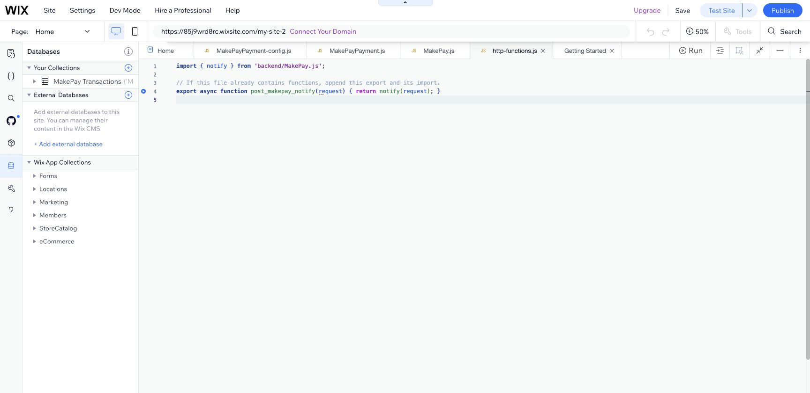
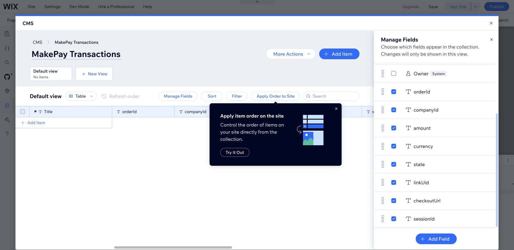
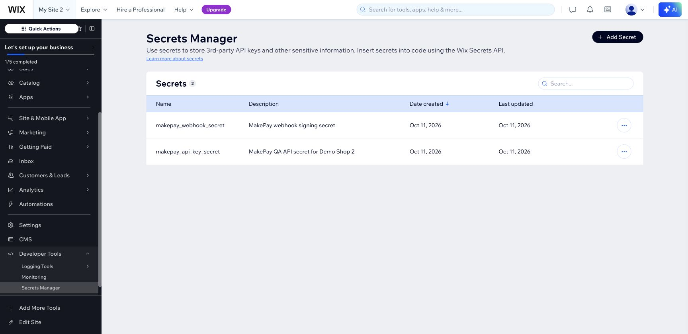
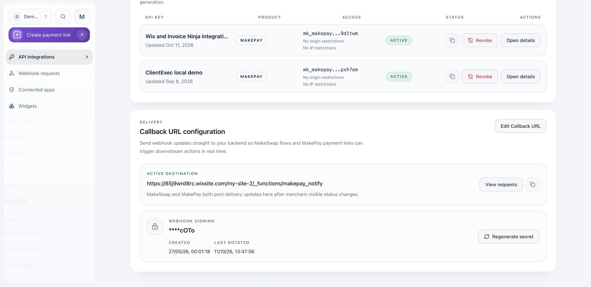
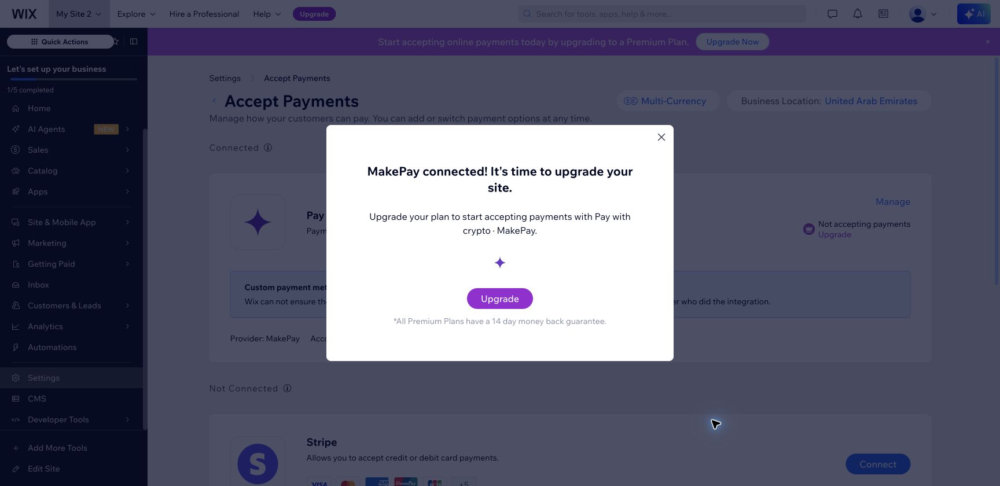

# Install MakePay in Wix Editor or Studio

This is a merchant-installed Velo provider, following the CoinPal installation model. It is not an App Market app. Use a USD store and a payment-enabled Wix plan. Harmony is not supported.

[Watch the captioned screenshot walkthrough](makepay-wix-tutorial.mp4). The captures below come from the actual Editor test installation. They show configuration and connection, not a funded payment.

## 1. Add the backend and payment plugin

Enable Dev Mode. Copy `Backend/MakePay.js` and `Backend/http-functions.js` into Backend. Append the HTTP function if your site already has that file. Create the Payment service plugin named `MakePayPayment`, accept Wix's terms, and copy both files from `MakePayPayment/` into it. Install npm `crypto-js` 4.2.0 in Packages & Apps.

## 2. Create the private collection

Create a multiple-item collection with ID `MakePayTransactions`. Restrict all permissions to Admin. Add eight Text fields: `orderId`, `companyId`, `amount`, `currency`, `state`, `linkUid`, `checkoutUrl`, `sessionId`. Keep the built-in `_id`.

## 3. Store secrets

In Developer Tools → Secrets Manager add `makepay_api_key_secret` and `makepay_webhook_secret`. Obtain the API credentials and company webhook signing secret from MakeCrypto → Integrations → API Integrations. Never show their values in screenshots or page code.

## 4. Publish and configure the callback

Publish the site. Under MakeCrypto's Callback URL configuration set `https://YOUR-WIX-DOMAIN/_functions/makepay_notify`. A company has one default callback: use separate companies or reviewed routing for multiple stores. Copy a newly generated signing secret immediately; rotating it invalidates the old value.

## 5. Connect MakePay

Open Wix Settings → Accept Payments. Connect **Pay with crypto · MakePay** using the company ID and API key ID. The connector validates the API credentials using your backend secret.

A connected provider on a free site still cannot accept payments. Enable a commerce plan before a live checkout. Set the store currency to USD in Language & Region.

## 6. Verify a controlled checkout

Use a USD product above the MakePay minimum. Check the amount on hosted checkout. Returning without paying must leave the order unpaid. A confirmed payment should update the original Wix transaction through a signed callback. Replay that delivery to verify duplicate protection. See [testing evidence and remaining live checks](TESTING.md).
