# Install MakePay in Wix

Follow these steps in order to add **Pay with crypto · MakePay** to your store. This is a merchant-installed Velo payment provider for **Wix Editor or Wix Studio**, using the same installation approach as CoinPal. Use an Editor or Studio site; Wix Harmony cannot run these Velo files.

[Open the source files](https://github.com/makepay-apps/makepay-wix) · [Watch the captioned installation video](makepay-wix-tutorial.mp4)

You need access to the site's code, CMS, Secrets Manager and payment settings. The screenshots show the classic Wix Editor; Studio may arrange these panels differently. Keep your store's price currency, such as EUR or USD. Crypto settlement is configured separately in MakeCrypto.

## 1. Get your MakePay credentials

Open your company in MakeCrypto, then **API & SDK → API Integrations**. Copy the **Company ID**. Click **Generate API key**, give it a title such as `Wix store`, choose **MakePay** as the product and **All** as the access level, then create the key.

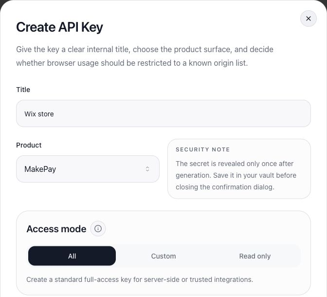

Save the **API key ID** and **API key secret**. The secret is shown only when the key is created. The backend needs permission to read and create MakePay payment links; the portal's **All** option supplies this access.

In **Callback URL configuration**, obtain the company's **webhook signing secret**. If one already exists, use the value you saved when it was generated. A masked existing value cannot be recovered from the portal. If it is lost, coordinate a rotation and update every integration using it.

You should now have four values: **Company ID**, **API key ID**, **API key secret** and **webhook signing secret**. Configure the company's receiving assets and settlement in MakeCrypto before testing payments.

## 2. Turn on Wix Dev Mode

Open **Edit Site** from the Wix dashboard. In the Editor's top bar, click **Dev Mode → Turn on Dev Mode**. The code workspace and backend tools will appear.


## 3. Create the two backend files

In the left toolbar, open **Backend & Public**. Beside **Backend**, click **+ → Add .js file** and name the file `MakePay.js`. Repeat for `http-functions.js`.

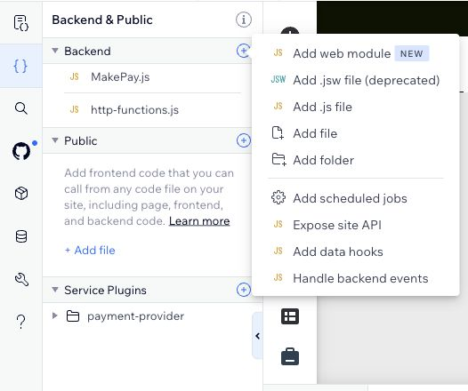

If `http-functions.js` already exists, keep its other functions. You will add the MakePay import and HTTP function to that file in step 5.

## 4. Create the Payment service plugin

In **Backend & Public**, beside **Service Plugins**, click **+ → Payment**.

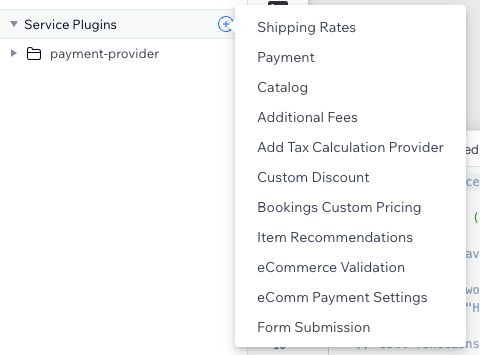

Read and accept Wix's custom payment-provider terms. When Wix asks for a plugin name, enter exactly **MakePayPayment**, then click **Add & Edit Code**.

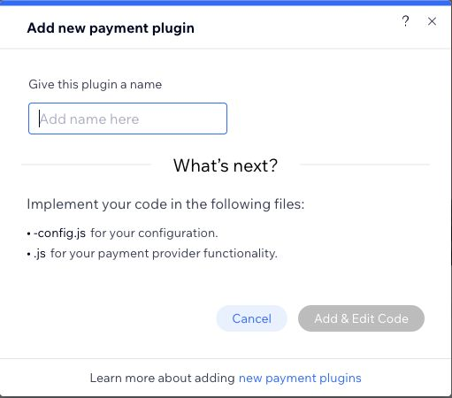

Wix creates a plugin folder containing `MakePayPayment-config.js` and `MakePayPayment.js`.

## 5. Copy the source into all four files

**GitHub repository:** [makepay-apps/makepay-wix](https://github.com/makepay-apps/makepay-wix)

Open each source link below. On GitHub, use **Raw** to view the complete file, then copy its contents into the matching Wix file. Save each file.

| Source file | Where to paste it in Wix |
| --- | --- |
| [Backend/MakePay.js](https://github.com/makepay-apps/makepay-wix/blob/main/Backend/MakePay.js) | **Backend → MakePay.js** |
| [Backend/http-functions.js](https://github.com/makepay-apps/makepay-wix/blob/main/Backend/http-functions.js) | **Backend → http-functions.js**; append the import and function if the file already exists |
| [MakePayPayment-config.js](https://github.com/makepay-apps/makepay-wix/blob/main/MakePayPayment/MakePayPayment-config.js) | **Service Plugins → payment-provider → MakePayPayment → MakePayPayment-config.js** |
| [MakePayPayment.js](https://github.com/makepay-apps/makepay-wix/blob/main/MakePayPayment/MakePayPayment.js) | **Service Plugins → payment-provider → MakePayPayment → MakePayPayment.js** |

Your file tree should now match this installed example:

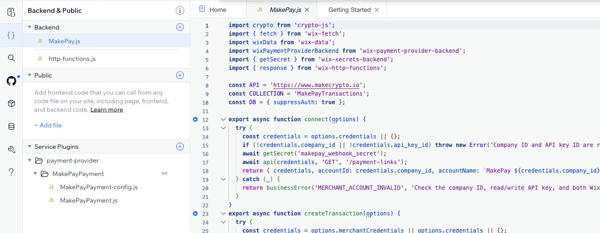

## 6. Install crypto-js

Open **Packages & Apps** in the Editor's left toolbar. Choose **Install packages from npm**, search for **crypto-js**, select the package named exactly `crypto-js`, and install version **4.2.0**.

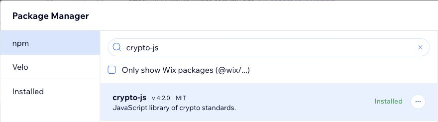

Continue when the package shows **Installed**.

## 7. Create the transaction collection

Open **Databases → Your Collections → +**. Choose **Content collection → Next → Start from scratch → Next**. Enter `MakePay Transactions` as the collection name and **MakePayTransactions** as its **collection ID**. Select **Multiple item collection**, then click **Create**.

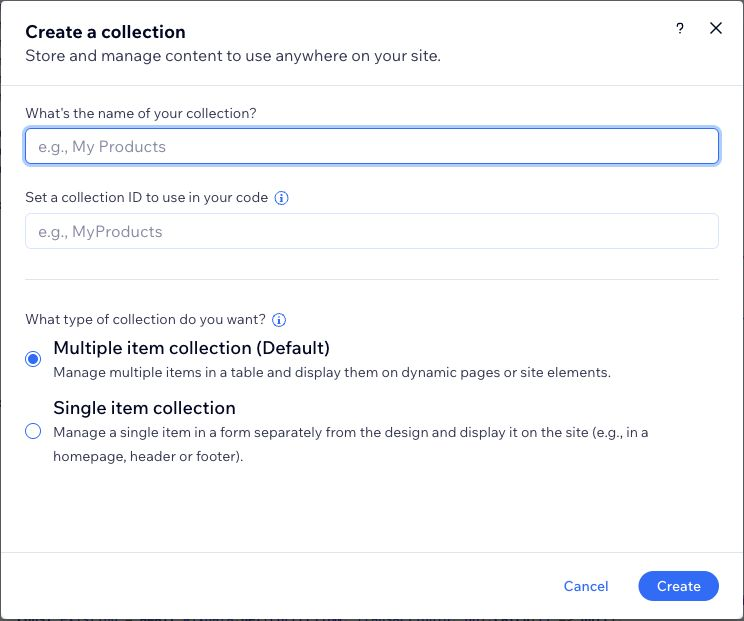

The display name can contain spaces; the collection ID must be exactly `MakePayTransactions`. Do not create a public dynamic page or connect this collection to page elements.

## 8. Restrict the collection to Admin

Beside the collection, open **… → Permissions & privacy**. Choose **Advanced**. Leave every **View**, **Add**, **Update** and **Delete** box unchecked for Everyone, Members, Item's creator and Collaborators. Only **Admin** should have access. Click **Save**.

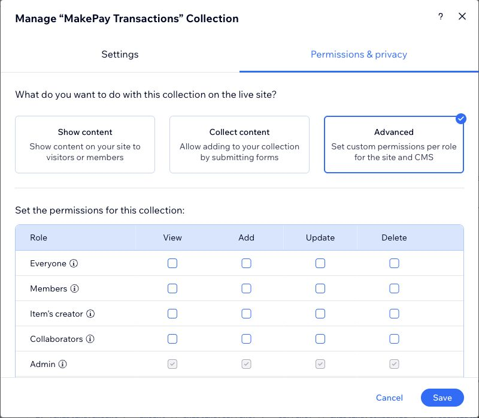

## 9. Add the eight Text fields

Open the collection and choose **Manage Fields → Add Field**. Select **Text** as the field type. Replace the default field name and ID with the first value below, click **Save**, and repeat for all eight fields.

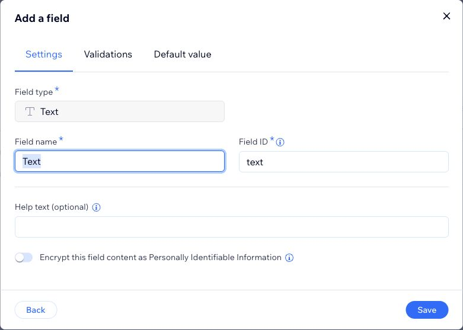

| Field name | Exact field ID | Type |
| --- | --- | --- |
| orderId | `orderId` | Text |
| companyId | `companyId` | Text |
| amount | `amount` | Text |
| currency | `currency` | Text |
| state | `state` | Text |
| linkUid | `linkUid` | Text |
| checkoutUrl | `checkoutUrl` | Text |
| sessionId | `sessionId` | Text |

Keep Wix's built-in fields, including `_id`. Check that all eight new fields appear in **Manage Fields**:

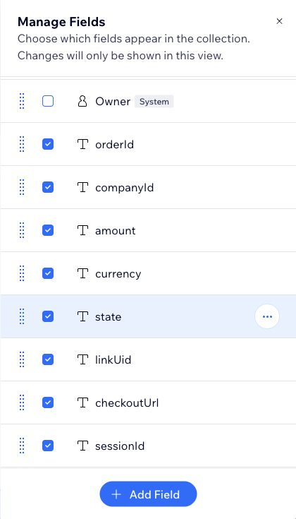

## 10. Add the two backend secrets

Return to the Wix dashboard and open **Developer Tools → Secrets Manager → Add Secret**. Create each entry below. Enter the name exactly, paste its value, and click **Add Secret**.

| Secret name in Wix | Value from MakeCrypto |
| --- | --- |
| `makepay_api_key_secret` | The API key secret from step 1 |
| `makepay_webhook_secret` | The company's webhook signing secret from step 1 |

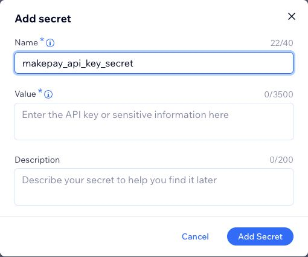

The screenshot leaves **Value** empty for privacy; paste your real secret there. Repeat for `makepay_webhook_secret`. Keep both values in Secrets Manager.

## 11. Publish the site

Return to the Editor and click **Publish** in the top-right corner. Wait for Wix to confirm publication. The files, npm package, collection and secrets must all be ready before proceeding.

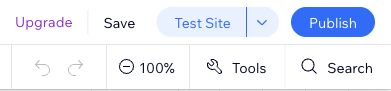

## 12. Save the callback URL in MakeCrypto

In MakeCrypto, open **API & SDK → API Integrations → Callback URL configuration → Set up Callback URL** (or **Edit Callback URL**). Enter your **published site's URL** followed by `/_functions/makepay_notify`, then click **Save**.

```text
https://YOUR-WIX-DOMAIN/_functions/makepay_notify
```

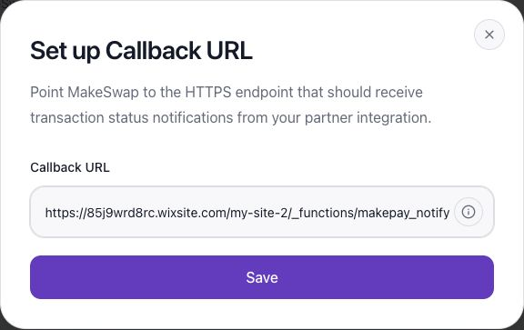

The screenshot uses our QA site as an example. Replace that domain and site path with yours. Use `/_functions/`, not `/_functions-dev/`. A company has one default callback URL; use a separate company for a store that needs a different callback from your existing integrations.

## 13. Connect MakePay in Wix

Open **Wix dashboard → Settings → Accept Payments → See More Payment Options**. Find **MakePay** and click **Connect**. Enter these two values, then click **Connect** on the form:

| Wix connection field | Value |
| --- | --- |
| MakePay company ID | Company ID copied in step 1 |
| MakePay API key ID | API key ID saved in step 1 |

The API key **secret** belongs in Secrets Manager, not in these two fields. After a successful connection, Wix shows **MakePay connected** and the payment method **Pay with crypto · MakePay**.

Wix may display a general notice about matching account currencies. Keep your store currency: EUR-priced orders open EUR payment links and USD-priced orders open USD payment links. The crypto settlement asset does not change the store's price currency.

## 14. Check the customer checkout

Open your published store, add a test product priced above MakePay's minimum, and proceed to checkout. Select **Pay with crypto · MakePay**, place the order and check that the hosted MakePay checkout displays the original amount and currency.

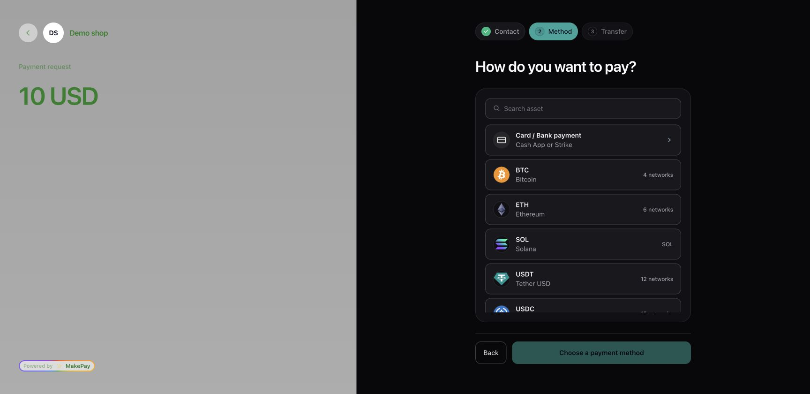

This example is an unfunded QA checkout. Returning without paying must leave the order unpaid. For production validation, complete a controlled payment and confirm that the original Wix order becomes **Paid** after its signed webhook. Review failures in MakeCrypto's **Webhook requests**. Returning to Wix alone does not confirm payment.

### Free owner test order

For a free QA site, follow [Wix's owner test-order instructions](https://support.wix.com/en/article/previewing-the-checkout-process-1420066):

1. Enable a **Manual Payment** option in Accept Payments and add the **Members Area** to the site.
2. Sign into the published storefront with the **same email as the Wix site owner**.
3. Add a dedicated QA product and choose **I just want to place a test order** at checkout.
4. Continue with QA details, select **Pay with crypto · MakePay**, and verify the hosted amount.

This route does not require buying a plan. Ordinary customer payments require a payment-enabled Wix plan. See the [validation record](TESTING.md) for USD/EUR checks, simulated callbacks and the native test-order results.

## Troubleshooting

- **No backend tools:** enable Dev Mode on an Editor or Studio site. Harmony does not support this connector.
- **No MakePay provider:** check the plugin name, both service-plugin files, crypto-js installation and successful publication.
- **Connection rejected:** check the company ID, key ID, MakePay API access and both backend secret names and values.
- **Checkout blocked on a free site:** use the owner test route above for QA, or enable a payment-capable plan for customer payments.
- **Paid checkout but unpaid Wix order:** check the published callback URL, matching webhook secret and all eight collection field IDs, then retry the failed delivery.
- **Creation pending:** follow the [recovery procedure](https://github.com/makepay-apps/makepay-wix#recovery) before creating another link for the same order.
- **Refunds:** issue and verify them manually in MakePay, then record them in Wix. Automated refunds are not supported.
